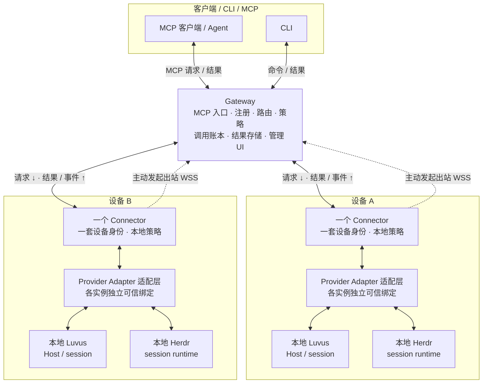

<p align="center">
  
</p>

<p align="center"><a href="README.md">English</a> · <strong>简体中文</strong></p>

# Rovloom

Rovloom 是面向 Luvus 与 Herdr、规划中的多机器 MCP Gateway 与主动出站 Connector。
目标是由一个 Gateway 将获授权请求路由到多台设备，每台设备运行一个 Connector，
并为各本地 runtime 配置独立适配器。
当前仓库为 [ArnoChenFx/Rovloom](https://github.com/ArnoChenFx/Rovloom)。
正式方案见 [系统设计](docs/DESIGN.md) 与 [实施计划](docs/IMPLEMENTATION-PLAN.md)。

<a id="name-and-compatibility-identifiers"></a>

## 名称与兼容标识

产品名、页面标题和面向用户的文案使用 **Rovloom**，小写文本 slug 为 `rovloom`。
Runtime provider 支持仍在规划中；品牌更名不代表可运行的 Gateway、Connector 或适配器已完成。

| 保留标识 | 含义 |
| --- | --- |
| 历史 URL 与记录中的 `ArnoChenFx/luvus-mcp` | 仓库旧名；当前仓库为 `ArnoChenFx/Rovloom` |
| `package.name=luvus-mcp` 及锁文件中对应的 workspace 名 | 现有私有包身份，为兼容保留 |
| CLI 设计示例中的 `luvus-mcp` | 保留的可执行标识；尚未实现可运行 CLI |
| `luvus_*` | 仅用于 Luvus 的兼容工具名；通用 runtime 工具按 ADR 0004 使用 `runtime_*` |
| 现有环境变量、协议字段、ID 与 schema 名 | 机器接口；品牌更名不修改这些标识 |
| Luvus / Herdr 及其原生命令 | 独立于 Rovloom 产品名的原生 runtime 名；实现状态见下文 |
| 历史命令、路径、报告、日志、fixture、哈希及署名 | 原始证据与来源；不改写成以新品牌产出的证据 |

## 当前状态

**当前只有基础层，尚不可作为 MCP Server 或 Connector 运行。**
基础层不会安装公网 listener、凭据或服务。未合并的整合工作不计入这里的已实现能力。

已实现：

- 基础层的显式 machine/profile/session 目标及 caller/local 策略精确求交；
  provider 级目标与持久化仍待实现。
- SQLite 设备注册、规范化唯一名称、一次性 enrollment 与设备凭据哈希。
- 重复设备拒绝、连接 epoch、撤销及归属于 principal 的调用记录。
- 规范化 request key 去重、响应关联及保守的重启/断线恢复。
- 单 writer 锁与 POSIX 数据库文件权限。
- 带授权检查的 Router，以及持久保存的 profile/session/method/deadline 上下文。
- 去重结果句柄、字节分页、载荷配额、TTL 与撤销清理。
- 显式清理响应，同时保留调用元数据与 request key 墓碑；清理需要独立权限。
- 带版本的业务 envelope 草稿 codec 与单测；尚未接入传输。

尚未实现：WSS、MCP 入口、UHP 适配器/schema 校验、凭据轮换、全库保留/配额、流、
HTTP OAuth、CLI 或部署。Store 方法是内部原语，不是可远程访问或独立授权的 API。
Linux P0 原生证据、脱敏 fixture 与逐方法覆盖账本见 [P0 报告](docs/p0/REPORT.md)；
这些证据不代表 Gateway/Connector 或 P1 已完成。

| 规划能力 | 门禁 / 当前边界 |
| --- | --- |
| 多 runtime 路由与 wire v2 | [ADR 0004](docs/adr/0004-multi-runtime-provider.md) 已定义 provider 身份、原生契约与隔离；基础层尚未接线 |
| 认证与主动 WSS | 端到端 caller/device 认证、配对/轮换控制面与网络接线尚未实现 |
| Provider 持久化与存储安全 | Provider 迁移、完整保留/配额、恢复隔离及可靠晚到证据持久化仍待实现；已有 SQLite 原语范围更窄 |
| Luvus 适配器与事件/终端传输 | 已有 Linux 原生 P0 证据；生产适配器及端到端流仍待实现 |
| Herdr 执行 | 仅为 candidate，独立 **P0-H** 原生实证通过前默认拒绝；首切片仅发现/状态、已核实被动只读及事件触发的状态重建，写入与终端控制另行验收 |
| Gateway 内置 Web UI | [规划中](docs/GATEWAY-WEBUI.md)，issue [#14](https://github.com/ArnoChenFx/Rovloom/issues/14)；依赖 #5/#6/#8，顺序为 #8 → #14 → #9 |

## 目标架构

**下图展示目标设计。** 上层是客户端，中层是 Gateway，
下层是相互独立的设备。每台设备一套身份、一个主动出站 Connector；同一个 Connector
可运行多个 Provider Adapter，也可绑定多个同 kind runtime 实例。

<!-- Keep this fence identical to docs/assets/architecture/target.zh.mmd. -->


虚线箭头表示 **Connector → Gateway 的连接发起方向**。
实线箭头表示已建立通道上的业务流：请求沿 **Gateway → Connector → Provider Adapter →
本地 runtime** 下行，结果与事件沿原路返回。双向业务流不代表 Gateway 主动向设备建立入站连接。
客户端节点表示通用集成角色；实现进度与验收门禁统一列在 [当前状态](#当前状态)。

MCP 目标入口为本地 stdio 或带认证的 HTTPS Streamable HTTP；Connector 使用另一套版本化 WSS 协议。
调用必须显式指定 `machine_id + provider_id + profile + session` 与 `expected_binding_revision`，
由 Gateway 和 Connector 双层检查授权。Luvus 的 Host/session 与 Herdr 的仅 session 原生契约独立保留，
不把 Herdr 转写成 UHP。内置 Web UI 是受保护管理面。

不支持 Mermaid 的阅读器可按以下文字理解：**客户端 / CLI / MCP ⇄ Gateway ⇄
每设备一个 Connector ⇄ Provider Adapter ⇄ 本地 Luvus / Herdr**。
维护说明见 [双语图源与图例](docs/assets/architecture/README.md)、[系统设计](docs/DESIGN.md)
与 [ADR 0004](docs/adr/0004-multi-runtime-provider.md)。

## 开发

使用 **Bun 1.4.3**；`.bun-version`、`packageManager` 与 CI 保持一致。
依赖固定在文本 `bun.lock` 中；MCP SDK 保持 1.32.1。
SQLite 仍导入 `node:sqlite`，由 Bun 的兼容实现提供；已验证的 Linux 构建使用真实 SQLite 3.53.4，
无需 Node 可执行程序。严格类型检查通过 Bun 独立运行固定的 TypeScript 7.0.2。
构建目标为 Bun ESM，保留 `dist/src/{contracts,store,router,protocol}.js`。
尚无 Server/Connector CLI。证据与平台限制见 [迁移报告](docs/bun/REPORT.md)
及 [ADR 0003](docs/adr/0003-bun-toolchain.md)。

```sh
bun --no-env-file install --frozen-lockfile --ignore-scripts
bun --no-env-file run toolchain
bun --no-env-file run typecheck
bun --no-env-file test ./test
bun --no-env-file run test:p0
bun --no-env-file run test:bun
bun --no-env-file run p0:audit
bun --no-env-file run p0:bun-native
bun --no-env-file run build
bun --no-env-file run smoke
bun --no-env-file run verify --output /tmp/luvus-bun-verification
```

完整 `verify` 工作流需要 Linux、Python 3 与 `strace`，会创建并删除一次性项目。
以上是开发检查命令，不是 Gateway/Connector 服务的安装或启动命令。

`bunfig.toml` 禁用自动加载 `.env` 与安装生命周期脚本；工作流命令和 stdio 子进程也传入
`--no-env-file`。新增 `trustedDependencies` 或启用生命周期脚本前，先审查具体需要。
原始测试与 P0 fixture/报告保持原样，历史 Node 24 结果仍描述当时的真实执行。
新增 Bun 证据单独保存在 `docs/bun/`。

证据与限制见 [开发进度](docs/PROGRESS.md)，2026-10-18 开发交接从 [HANDOVER](docs/HANDOVER.md) 开始。
基础层最初在 `feat/reviewed-core-foundation` / Draft PR #1 开发。
草稿 codec 尚不校验完整安装 UHP schema，也未实现协商后的 minor 版本。
已发布的 issue #3 分支提供原生证据与 [ADR 0001](docs/adr/0001-p0-version-and-contract-baseline.md)，
但生产适配器仍未实现。安装 schema 中有 144 个方法仅含通用参数对象；固定版本的 MCP SDK
实际协商 2025-11-25，而非设计讨论中较新的 2026-07-28 revision。

## 存储安全

调用方须提供私有状态目录；POSIX 上数据库与锁文件使用 0600，尚无 Windows ACL 保证。
Enrollment 或设备秘密不得进入 MCP content、日志或命令参数。
Enrollment 签发与兑换是供未来受保护通道使用的管理原语。

`.lock` 文件阻止并发 writer，崩溃后会有意保留。操作员必须先确认没有 writer 存活、备份数据库，
再移除陈旧锁并重新打开；不得删除活跃 writer 的锁。
句柄 TTL 不会删除内联调用响应。显式清理只移除逻辑响应与句柄，不代表清除取证副本、
SQLite 空闲页或备份。自动响应保留与全库配额仍待实现。

恢复时设备标为 offline，已派发调用标为 `outcome_unknown`，不自动执行持久保存的请求。
Request key 去重不构成 exactly-once 保证；当前 schema 保存哈希，不保存待执行请求载荷。
