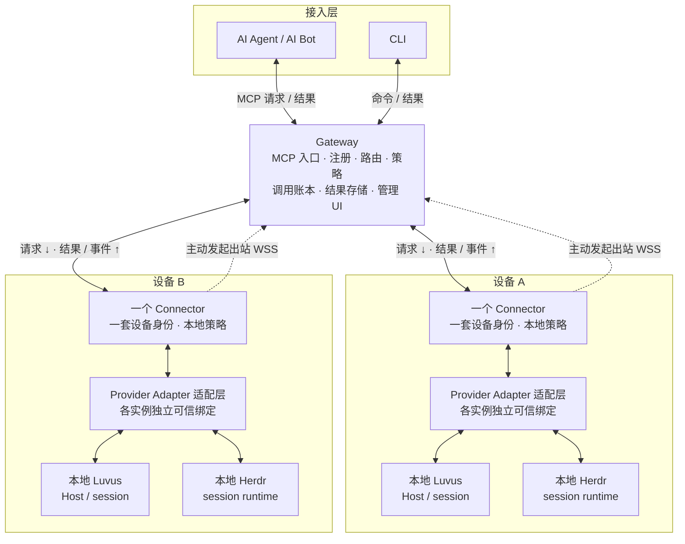

<p align="center">
  
</p>

<p align="center"><a href="README.md">English</a> · <strong>简体中文</strong></p>

# Rovloom

让 AI Agent / AI Bot 通过 MCP 统一入口访问多台设备上的本地 Luvus 与 Herdr runtime。
Rovloom 采用一个 Gateway、每设备一个主动出站 Connector 的架构，
让 runtime 留在各自机器上，AI Agent / AI Bot 通过同一入口访问。

**当前可用范围：** Linux/macOS/Windows Gateway 与 Linux x64 / Windows x64 Connector（附着你已在运行的 Herdr / Luvus）的技术预览。
已提供官方二进制、安装脚本和 Linux Gateway Docker 镜像，参见[快速开始](docs/QUICK-START-zh.md)
与 [Docker 部署](docs/DOCKER-zh.md)。首次配对需要真实本地终端，目前一个 Gateway 引导式配对一台 Connector
（[#192](https://github.com/ArnoChenFx/Rovloom/issues/192)）；Agent/模型登录引导尚不可用。

## 核心能力

目标产品提供以下能力：

- **多设备接入：** 各设备的 Connector 主动出站连接到同一个 Gateway。
- **显式目标：** 每次操作明确选择设备、runtime 实例与 session。
- **原生适配：** Luvus 与 Herdr 分别保留各自的契约和能力边界。
- **受控访问：** Gateway 与本地策略共同约束调用、结果和流，并提供内置设备与 runtime 管理。

## 架构

上层是 AI Agent / AI Bot 与 CLI，中层是 Gateway；下层每台设备运行一个 Connector 与本地 Provider Adapter。
同一个 Connector 可以管理多个 runtime 实例。

<!-- Keep this fence identical to docs/assets/architecture/target.zh.mmd. -->



## 典型用法：两台机器，一个 Agent

你的工作站上运行着真正在用的 Herdr（或 Luvus），里面有你的工作区和 Agent 登录；一台常开的小主机运行 Gateway。
AI 客户端通过 MCP 访问 Gateway，并操作工作站上的真实会话——工作站上的 Connector 只向外拨号，
工作站不需要开放入站端口，对外只暴露 Gateway 的一个 MCP 入口。

1. Gateway 主机：`rovloom gateway`（设置 `devices.hostname` 让工作站能连上；跨出可信网络时在前面放 HTTPS/WSS 代理）。
2. 工作站：`rovloom connector`，输入 Gateway 地址和一次性码。
3. 把 Gateway 的 MCP 地址和 Bearer 加到 AI 客户端，让它列出这台机器的工作区。

断线后结果不确定的调用会标为未知，不会自动重发。令牌、管理页、重新配对和排错见[运维指南](docs/OPERATIONS.md)。

## 快速开始

从[快速开始](docs/QUICK-START-zh.md)了解安装前提、Gateway/Connector 配置路径、启动、
HTTP MCP 接入与 Agent 使用。[配置参考](docs/CONFIGURATION-zh.md)列出精确参数和完整无秘密模板。
本地终端引导可配对一个 Connector 并初始化已安装的 Luvus、Herdr 或两者；
Agent/模型仍需独立准备。

```sh
rovloom --version
rovloom --help
```

## 文档

- [系统架构与部署](docs/DESIGN.md)
- [运维指南](docs/OPERATIONS.md)
- [协议总览](docs/PROTOCOL.md)
- [Runtime 接口](docs/adr/0004-multi-runtime-provider.md)
- [路线（issues）](https://github.com/ArnoChenFx/Rovloom/issues)
- [管理 UI 设计](docs/GATEWAY-WEBUI.md)
- [开发与验证](docs/DEVELOPMENT.md)
- [开机服务模块与接线边界](docs/SERVICE.md#简体中文)

## 许可证

[MIT 许可证](LICENSE)
