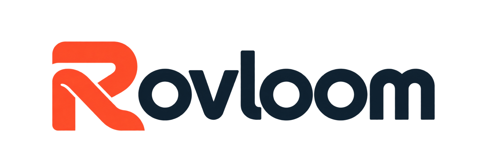
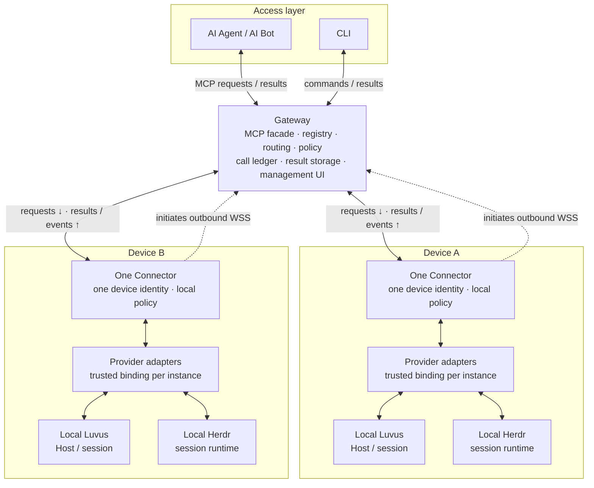

<p align="center">
  
</p>

<p align="center"><strong>English</strong> · <a href="README-zh.md">简体中文</a></p>

# Rovloom

Connect your AI Agent / AI Bot to local Luvus and Herdr runtimes across devices through MCP.
Rovloom is designed around one Gateway and one outbound Connector per device,
so runtimes stay on their own machines with a common entry point for AI Agent / AI Bot.

**Availability:** Technical preview with a Linux/macOS/Windows Gateway and Linux x64
Connector setup. First-pairing approval requires Linux. No public installation
package or guided Agent/model login is available yet; see the [Quick Start](docs/QUICK-START.md).

## Core capabilities

The target product is designed to provide:

- **Multi-device access:** Connectors initiate outbound connections to a shared Gateway.
- **Explicit targets:** Select a device, runtime instance and session for each operation.
- **Native runtime adapters:** Keep Luvus and Herdr contracts and capabilities separate.
- **Controlled access:** Apply Gateway and local policies to calls, results and streams,
  with built-in device and runtime management.

## Architecture

AI Agent / AI Bot and CLI sit above the Gateway; each device below it runs one
Connector and its local provider adapters. A Connector can manage multiple runtime instances.

<!-- Keep this fence identical to docs/assets/architecture/target.en.mmd. -->



## Quick start

Follow the [Quick Start](docs/QUICK-START.md) for installation prerequisites,
Gateway/Connector configuration paths, startup, HTTP MCP access and Agent use.
The [configuration reference](docs/CONFIGURATION.md) lists the exact settings
and complete non-secret templates. Local terminal setup can pair one Connector
and initialize installed Luvus, Herdr or both; Agent/model setup remains a
separate prerequisite.

```sh
rovloom --version
rovloom --help
```

## Documentation

- [Architecture and deployment](docs/DESIGN.md)
- [Runtime interfaces](docs/adr/0004-multi-runtime-provider.md)
- [Implementation roadmap](docs/IMPLEMENTATION-PLAN.md)
- [Management UI design](docs/GATEWAY-WEBUI.md)
- [Development and validation (Bun 1.4.3)](docs/DEVELOPMENT.md)
- [Boot service module and integration limits](docs/SERVICE.md)

## License

[MIT License](LICENSE)
