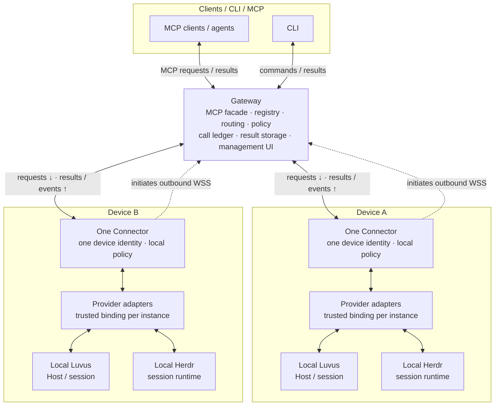

<p align="center">
  
</p>

<p align="center"><strong>English</strong> · <a href="README-zh.md">简体中文</a></p>

# Rovloom

Rovloom is a planned multi-machine MCP gateway and outbound connector for Luvus
and Herdr. One Gateway is designed to route authorized requests to multiple devices,
with one outbound Connector per device and separate adapters for each local runtime.
The repository is [ArnoChenFx/Rovloom](https://github.com/ArnoChenFx/Rovloom).
The normative proposal is in [docs/DESIGN.md](docs/DESIGN.md) and
[docs/IMPLEMENTATION-PLAN.md](docs/IMPLEMENTATION-PLAN.md).

## Name and compatibility identifiers

Use **Rovloom** for product names, page titles and user-facing copy; the lowercase
text slug is `rovloom`. Runtime-provider support remains planned; this name change
does not add a runnable gateway, connector or adapter.

| Retained identifier | Meaning |
| --- | --- |
| `ArnoChenFx/luvus-mcp` in historical URLs and records | Former repository name; the current repository is `ArnoChenFx/Rovloom` |
| `package.name=luvus-mcp` and the matching lockfile workspace name | Existing private package identity, retained for compatibility |
| `luvus-mcp` in CLI design examples | Retained executable identifier; a runnable CLI has not been implemented |
| `luvus_*` | Luvus-only compatibility tool names; generic runtime tools use `runtime_*` as specified in ADR 0004 |
| Existing environment variables, protocol fields, IDs and schema names | Machine interfaces; this branding change does not rename them |
| Luvus / Herdr and their native commands | Native runtime names, independent of the Rovloom product name; implementation status is listed below |
| Historical commands, paths, reports, logs, fixtures, hashes and attributions | Original evidence and provenance; not rewritten to imply they were produced under the new name |

## Current status

Foundation only, not a runnable MCP server or connector. No public listener,
credentials, or services are installed by this foundation. Unmerged integration
work is not counted as implemented here.

Implemented:

- Foundation machine/profile/session targets and exact caller/local policy intersection;
  provider-scoped targets and persistence are still pending.
- SQLite machine registry, normalized unique names, one-time enrollment and hashed device credentials.
- Duplicate-device rejection, connection epochs, revocation and principal-owned call records.
- Canonical request-key deduplication, response correlation and conservative restart/disconnect recovery.
- Single-writer lock and database file permissions on POSIX.
- Authorized Router and durable profile/session/method/deadline context.
- Deduplicated result handles with byte pagination, payload quota, TTL and revocation cleanup.
- Explicit response discard preserving call metadata and request-key tombstones, with a separate deletion permission.
- Draft versioned business-envelope codec and unit tests; not integrated with any transport.

Not implemented: WSS, MCP facade, UHP adapter/schema validation, credential rotation,
global database retention/quotas, streaming, HTTP OAuth, CLI, or deployment. Store methods are
internal primitives, not remotely accessible or independently authorized APIs.
Linux P0 native evidence is now available for review in
[docs/p0/REPORT.md](docs/p0/REPORT.md), with sanitized fixtures and a per-method
coverage ledger. This does not imply Gateway/Connector or P1 completion.

| Planned capability | Gate / current boundary |
| --- | --- |
| Multi-runtime routing and wire v2 | [ADR 0004](docs/adr/0004-multi-runtime-provider.md) defines provider identity, native contracts and isolation; the foundation is not wired to them |
| Authentication and outbound WSS | End-to-end caller/device authentication, pairing/rotation control plane and network wiring remain unimplemented |
| Provider persistence and storage safety | Provider migration, complete retention/quotas, recovery quarantine and reliable late-evidence persistence remain pending; existing SQLite primitives are narrower |
| Luvus adapter and event/terminal transport | Native Linux P0 evidence exists; production adapter and end-to-end streams remain pending |
| Herdr execution | Candidate only; denied by default until independent **P0-H** native evidence passes. The first slice is limited to discovery/status, verified passive reads and event-driven state rebuild; writes and terminal control need separate validation |
| Built-in Gateway Web UI | [Planned](docs/GATEWAY-WEBUI.md), issue [#14](https://github.com/ArnoChenFx/Rovloom/issues/14); depends on #5/#6/#8, with #8 → #14 → #9 sequencing |

## Target architecture

**The diagram shows the target design.** The top tier is
clients, the middle tier is the Gateway, and the bottom tier contains independent
devices. Each device has one identity and one outbound Connector; that Connector
can host multiple provider adapters and multiple instances of the same runtime.

<!-- Keep this fence identical to docs/assets/architecture/target.en.mmd. -->


Dashed arrows show **Connector → Gateway connection initiation**. Solid arrows
show application traffic on the established channel: requests travel
**Gateway → Connector → provider adapter → local runtime**; results and events
return along the same path. Bidirectional traffic does not mean the Gateway
opens an inbound connection to a device. Clients are generic integration roles.
Implementation status and validation gates are listed in [Current status](#current-status).

The MCP entry is local stdio or authenticated HTTPS Streamable HTTP.
The Connector channel is a separate versioned WSS protocol. Calls use explicit
`machine_id + provider_id + profile + session` targets and
`expected_binding_revision`, with authorization checked at both Gateway and
Connector. Luvus Host/session and Herdr session-only contracts stay separate;
Herdr is not translated into UHP.
The built-in Web UI is a protected management surface.

For renderers without Mermaid, the flow is: **clients / CLI / MCP ⇄ Gateway ⇄
one Connector per device ⇄ provider adapters ⇄ local Luvus / Herdr**.
See the [bilingual diagram sources and legend](docs/assets/architecture/README.md),
[DESIGN](docs/DESIGN.md) and [ADR 0004](docs/adr/0004-multi-runtime-provider.md).

## Development

Use **Bun 1.4.3** (`.bun-version`, `packageManager` and CI agree).
Dependencies are pinned in the text `bun.lock`; SDK remains 1.32.1.
SQLite still imports `node:sqlite`, supplied by Bun's compatibility implementation;
the verified Linux build uses real SQLite 3.53.4 and needs no Node executable.
Strict typechecking independently runs pinned TypeScript 7.0.2 through Bun.
Builds target Bun ESM and retain `dist/src/{contracts,store,router,protocol}.js`.
No server/connector CLI exists yet. See [the migration report](docs/bun/REPORT.md)
and [ADR 0003](docs/adr/0003-bun-toolchain.md) for evidence and platform limits.

```sh
bun --no-env-file install --frozen-lockfile --ignore-scripts
bun --no-env-file run toolchain
bun --no-env-file run typecheck
bun --no-env-file test ./test
bun --no-env-file run test:p0
bun --no-env-file run test:bun
bun --no-env-file run p0:audit
bun --no-env-file run p0:bun-native
bun --no-env-file run build
bun --no-env-file run smoke
bun --no-env-file run verify --output /tmp/luvus-bun-verification
```

The full `verify` workflow requires Linux, Python 3 and `strace`; it creates and
removes a disposable project. These are development checks, not installation
or launch commands for a Gateway/Connector service.

`bunfig.toml` disables automatic `.env` loading and install lifecycle scripts.
Workflow commands and stdio children also pass `--no-env-file`. Do not add
`trustedDependencies` or enable lifecycle scripts without reviewing a concrete need.
The original 20 tests and P0 fixtures/reports remain intact; historical Node 24
results describe their original runs. New Bun evidence is under `docs/bun/`.

See [docs/PROGRESS.md](docs/PROGRESS.md) for evidence and limitations.
For the 2026-10-18 development handover, start with [docs/HANDOVER.md](docs/HANDOVER.md).
The foundation was developed on `feat/reviewed-core-foundation` / Draft PR #1.
The draft codec does not yet
validate the full installed UHP schema or implement negotiated minor versions.
The published issue #3 task branch adds native evidence and
[ADR 0001](docs/adr/0001-p0-version-and-contract-baseline.md); the production
adapter is still absent. The installed schema has only generic parameter
objects for 144 methods, and the pinned MCP SDK negotiates 2025-11-25 rather
than the newer 2026-07-28 revision discussed in the design.

## Storage safety

The caller must supply a private state directory; database and lock files use
0600 on POSIX. There is no Windows ACL guarantee yet. Never publish enrollment
or device secrets in MCP content, logs or command arguments. Enrollment issuing
and redeeming are administrative primitives for a future protected channel.

A `.lock` file prevents concurrent writers. A crash intentionally leaves it in
place. An operator must confirm no writer is alive, back up the database, then
remove the stale lock before reopening. Never remove a live writer's lock.
Handle TTL does not delete inline call responses. Explicit response discard removes
logical response data and handles, not forensic copies, SQLite free pages or backups.
Automatic response retention and whole-database quotas are still pending.

Recovery marks machines offline and dispatched calls `outcome_unknown`; no
persisted request is automatically executed. Request-key deduplication is not an
exactly-once guarantee. This schema stores hashes, not queued request payloads.
