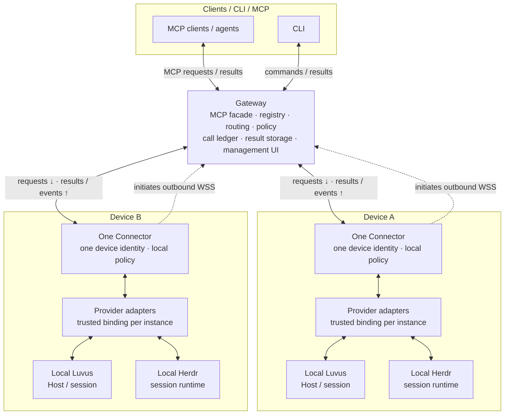

<p align="center">
  
</p>

<p align="center"><strong>English</strong> · <a href="README-zh.md">简体中文</a></p>

# Rovloom

Connect MCP agents to local Luvus and Herdr runtimes across your devices.
Rovloom is designed around one Gateway and one outbound Connector per device,
so runtimes stay on their own machines while clients use a common entry point.

**Availability:** Linux source/build preview. A deployable Gateway/Connector service
and remote runtime execution are not yet available.

## Core capabilities

The target product is designed to provide:

- **Multi-device access:** Connectors initiate outbound connections to a shared Gateway.
- **Explicit targets:** Select a device, runtime instance and session for each operation.
- **Native runtime adapters:** Keep Luvus and Herdr contracts and capabilities separate.
- **Controlled access:** Apply Gateway and local policies to calls, results and streams,
  with built-in device and runtime management.

## Architecture

Clients sit above the Gateway; each device below it runs one Connector and its
local provider adapters. A Connector can manage multiple runtime instances.

<!-- Keep this fence identical to docs/assets/architecture/target.en.mmd. -->


## Quick start

Use **Bun 1.4.3** to build the source preview:

```sh
git clone https://github.com/ArnoChenFx/Rovloom.git
cd Rovloom
bun install
bun run build
```

This builds the current core; service startup, device pairing and end-to-end
runtime access will be available in a later preview.

## Documentation

- [Architecture and deployment](docs/DESIGN.md)
- [Runtime interfaces](docs/adr/0004-multi-runtime-provider.md)
- [Implementation roadmap](docs/IMPLEMENTATION-PLAN.md)
- [Management UI design](docs/GATEWAY-WEBUI.md)
